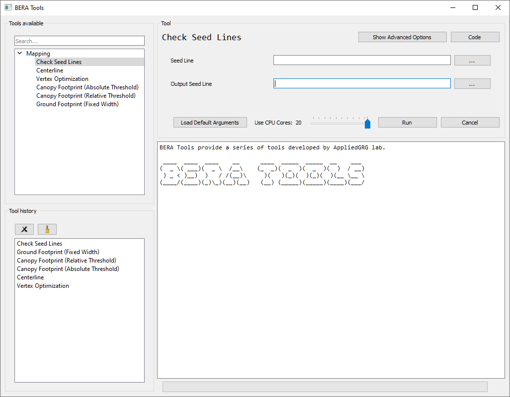
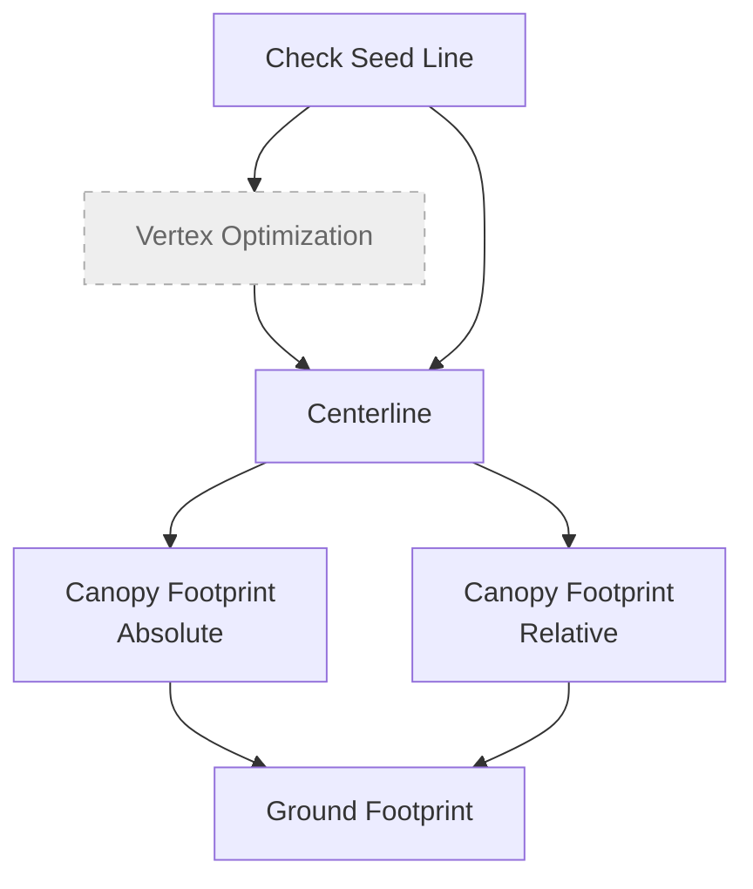

# Quick Start

Make sure [beratools is installed](user/installation.md). Run the command in MiniConda/Anaconda Prompt to start BERA Tools main gui.

``` bash
$ conda activate bera
$ beratools 
```

## Example Data

Start working with BERA Tools using example data.

[Download latest example data](https://github.com/BERATool/beratools/releases/latest/download/test_data.zip)

## Main GUI

BERA Tools provide a light weight GUI to use tools.



The BERA Tools main GUI consists of the following components:

| **Panel / Section** | **Description** |
|----------------------|-----------------|
| **Tool Selection Panel (Left)** | A tree view listing all available tools, organized by toolbox. Users can search for tools using the search bar at the top. Selecting a tool updates the main panel. |
| **Tool History / Pipeline tabs (Left, below tool selection)** | **Tool history** lists recently used tools for quick access, with options to clear or remove items.<br>**Pipeline** chains tools into steps that run one after another (see [Building a pipeline](#building-a-pipeline)). |
| **Main Panel (Right)** | **Top Section:** Shows the currently selected tool name, with buttons for advanced options, viewing code, and help.<br>**Tool Parameters:** Dynamic widgets for entering parameters required by the selected tool.<br>**Bottom Section:** Includes a slider to select the number of CPU cores, a button to load default arguments, and buttons to run or cancel the tool. |
| **Output and Progress (Bottom Right)** | A text area displays output, logs, and messages from tool execution.<br>A progress bar and label show the status of running tools. |

## Workflow Diagram



## Running the tools

=== "GUI"

    Select a tool, fill in the parameters and click **Run**. The tool's output streams into the log
    while it runs.

=== "bt command"

    ```bash
    bt list-tools                       # list the tool subcommands
    bt centerline                       # show the parameters for one tool
    bt centerline --in_line "<lines.gpkg>|<layer>" --in_raster <chm.tif> --out_line "<out.gpkg>|centerline" --proc_segments True -p 4
    ```

    `bt` (also available as `beratools`) reads each tool's parameters from `beratools.json`, converts
    values to the right type and rejects anything that isn't one of a list parameter's allowed values.

=== "Python module"

    ```bash
    python -m beratools.tools.centerline --in_line "<lines.gpkg>|<layer>" --in_raster <chm.tif> --out_line "<out.gpkg>|centerline" --proc_segments True
    ```

    `-p/--processes` sets the requested number of workers, and `-l/--log_level` sets the log level.

## Building a pipeline

The **Pipeline** tab, next to **Tool history** in the GUI, chains tools together so they run one
after another, without writing a script.

1. **Add steps**: drag tools from **Tools available** into the Pipeline tab. Dragging over the tab
   switches to it. You can also select a tool and click the add button. Drag steps, or use the arrow
   buttons, to change their order.
2. **Set each step's parameters**: click a step to open its parameters in the tool form. Your changes
   are kept in the step.
3. **Link steps**: **Inputs from earlier steps** sets which earlier step each input reads from, with one
   choice per input:
    - a line input (`in_line`) can come from **Check Seed Lines**, **Vertex Optimization**,
      **Centerline** or the centerline output of **Canopy Footprint (Relative Threshold)**;
    - a footprint input (`in_footprint`) can come from a canopy footprint step.

    Each input links to the latest earlier step that makes what it needs, which is not always the
    step just before it, and the links are reset this way whenever a step is added, moved or
    removed, replacing any you chose by hand. Linked fields are greyed out in the form and show what
    they will read, for example `D:/lines.gpkg|footprint`. Choose **Its own value** to use the
    path in the form instead. The list shows each step's links, for example
    `4. Ground Footprint ← steps 2, 3`.
4. **Run**: click **Run Pipeline**. The steps run in order with the CPU cores set by the slider, and
   their output streams into the log. The pipeline stops if a step fails, if a linked file is
   missing, or if you click **Cancel**.

For example, add **Check Seed Lines**, **Centerline**, **Canopy Footprint (Absolute Threshold)** and
**Ground Footprint**. The centerline step reads the checked lines, the canopy footprint reads the
centerlines, and the ground footprint reads both the centerlines and the canopy footprint. You only set
the seed lines, the CHM for each step that needs one, and each step's output.

### Saving and running a pipeline without the GUI

The buttons above the list save and load pipelines as `.json` files. A saved pipeline also runs from
the command line:

```bash
python -m beratools.core.pipeline my_pipeline.json --processes 4
```

!!! note
    A step only counts as failed if its tool exits with an error. If a tool prints a warning and
    stops normally instead, the next step then fails on its missing input, so check the log.

Which inputs can link to which outputs is set in `beratools.json`, so new tools can join pipelines
without code changes. See [Taking part in pipelines](developer/add_new_tool.md#taking-part-in-pipelines).

## Data Preparation

BERA Tools start with two main types of input data:

- **CHM** (GeoTIFF).
- **Seed Lines** (polylines): rough centerlines of seismic lines, which helps to detect accurate centerline.

Ensure your input data meets the following criteria:

- **Vector Format**: Supported vector formats include GeoPackage (.gpkg), Shapefile (.shp).
- **Raster Format**: Supported raster formats include GeoTIFF (.tif).
- **Coordinate System**: Data should be in a projected coordinate system (e.g., UTM) for accurate distance measurements.

## Troubleshooting

### Windows GDAL/PROJ Warning

On Windows, BERA Tools may display a warning if `GDAL_DATA` or `PROJ_LIB` point to a different Python environment than the one running BERA Tools. This can happen when OSGeo4W or another GDAL install is configured globally while you run a conda/venv environment.

Example warning:

```
[GDAL/PROJ Warning] Potential env mismatch
Python env: C:\Users\you\miniconda3\envs\bera
GDAL_DATA : C:\OSGeo4W\share\gdal
PROJ_LIB  : C:\OSGeo4W\share\proj
If you encounter GDAL/PROJ errors, ensure these env paths belong to this Python environment.
```

**How to fix it**:
- Prefer GDAL/PROJ bundled with your current Python environment.
- Remove or update `GDAL_DATA`/`PROJ_LIB` to point into the active Python environment.

